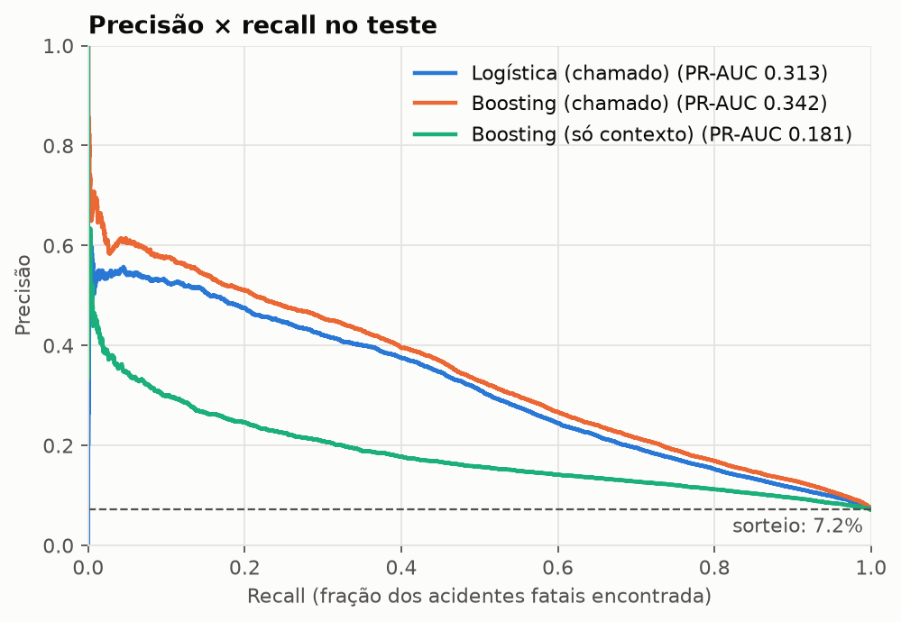
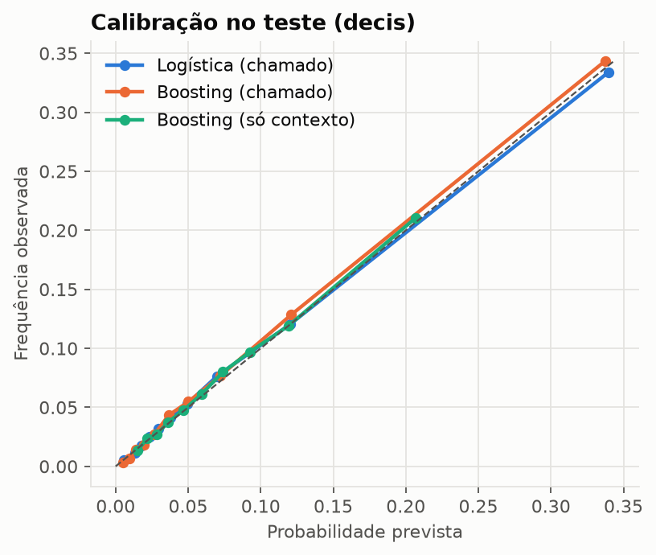
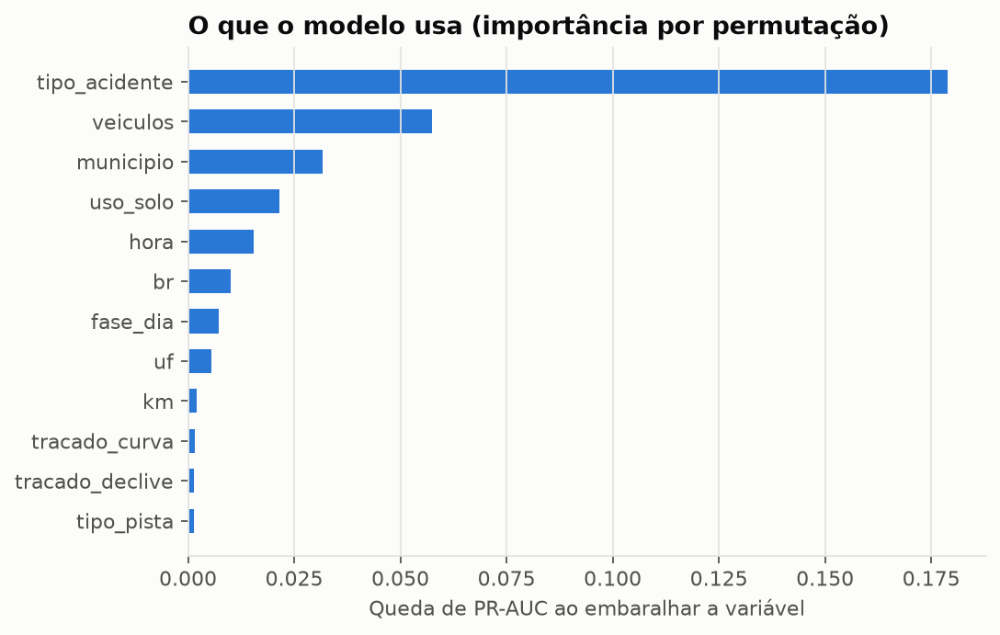
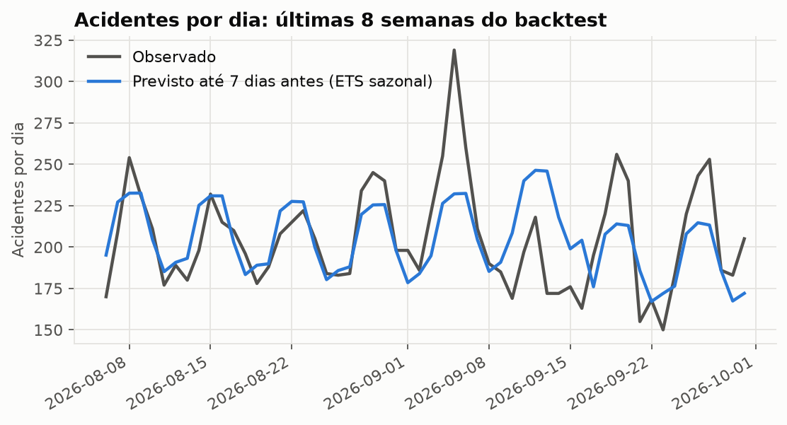
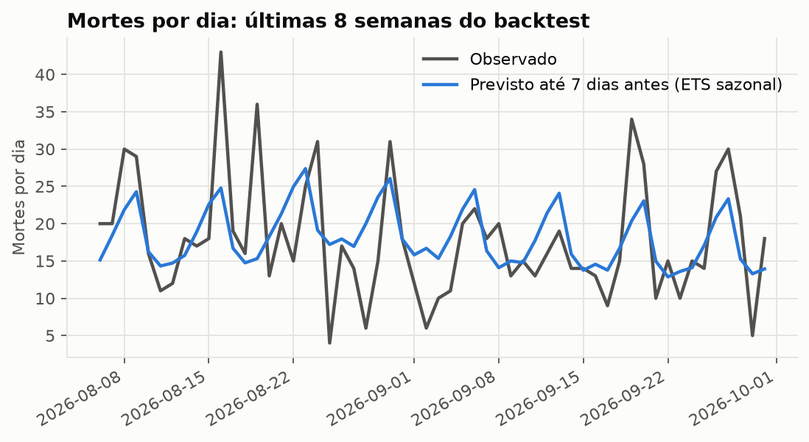

# Relatório de resultados

Gerado por `acidentes relatorio`. Não edite à mão.

## 1. Risco de fatalidade

Treino em 2017–2023 (486.982 acidentes), limiar escolhido em 2024 (73.202) e teste de 01/01/2025 a 30/09/2026 (127.424). No teste, 7,2% dos acidentes tiveram morte.

| Modelo | PR-AUC | ROC-AUC | Brier | Precisão | Recall | F1 | Captura no top 10% |
| --- | --- | --- | --- | --- | --- | --- | --- |
| Logística (chamado) | 0,313 | 0,815 | 0,0568 | 34,0% | 45,7% | 0,390 | 46,6% |
| Boosting (chamado) | 0,342 | 0,834 | 0,0554 | 36,5% | 45,5% | 0,405 | 47,9% |
| Boosting (só contexto) | 0,181 | 0,724 | 0,0630 | 17,4% | 41,1% | 0,244 | 29,4% |

Um classificador que sorteia teria PR-AUC igual à prevalência, 0,072. Precisão, recall e F1 usam o limiar que maximiza F1 na validação.

Leitura do modelo principal (Boosting (chamado)):

* Os 10% de acidentes com maior risco previsto concentram 47,9% dos fatais; dentro desse grupo, 34,4% têm morte.
* O desempenho é estável entre os anos de teste (PR-AUC 2025: 0,343, 2026: 0,341).
* Sem o tipo do acidente e o número de veículos, só com local e horário, a PR-AUC é 0,181, contra 0,342 do modelo principal.

## 2. Previsão diária

Backtest de origem móvel: 52 previsões de 7 dias, uma por semana, no último ano de dados (até 30/09/2026). MASE abaixo de 1 significa erro menor que repetir a semana anterior.

**Acidentes por dia** (média do último ano: 203,1)

| Modelo | MAE | MASE |
| --- | --- | --- |
| Ingênua sazonal | 23,3 | 1,05 |
| Média de 4 semanas | 18,1 | 0,81 |
| ETS sazonal ✔ | 17,5 | 0,78 |

**Mortes por dia** (média do último ano: 16,9)

| Modelo | MAE | MASE |
| --- | --- | --- |
| Ingênua sazonal | 5,9 | 1,07 |
| Média de 4 semanas | 4,7 | 0,87 |
| ETS sazonal ✔ | 4,3 | 0,78 |

### Próximos 7 dias

Intervalo de 80% tirado dos erros do backtest do modelo escolhido.

| Data | Dia | Acidentes | Intervalo | Mortes | Intervalo |
| --- | --- | --- | --- | --- | --- |
| 01/10/2026 | qui | 193 | 165–220 | 15 | 8–22 |
| 02/10/2026 | sex | 224 | 197–251 | 18 | 11–24 |
| 03/10/2026 | sáb | 231 | 204–258 | 22 | 15–28 |
| 04/10/2026 | dom | 230 | 202–257 | 24 | 18–31 |
| 05/10/2026 | seg | 202 | 174–228 | 16 | 10–23 |
| 06/10/2026 | ter | 184 | 156–210 | 14 | 8–21 |
| 07/10/2026 | qua | 188 | 161–215 | 14 | 8–21 |
